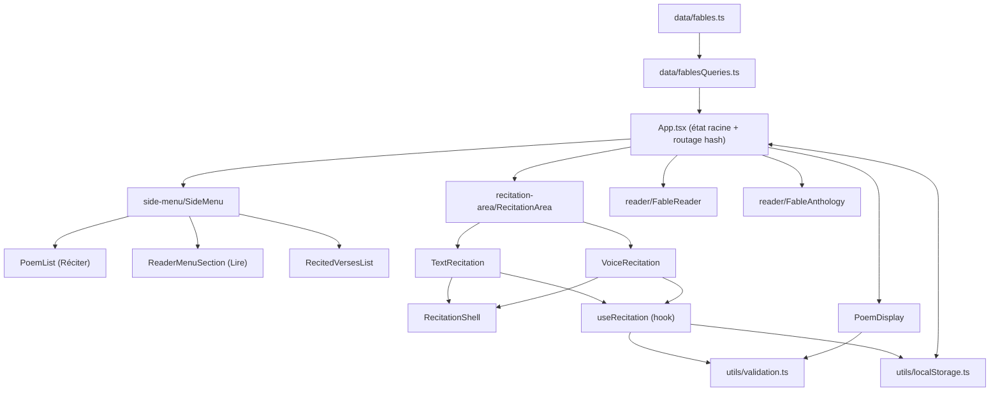

# Architecture du projet

Ce document décrit l'architecture de l'application **Les Fables de La Fontaine**, ses flux de données, ses règles métier et ses choix techniques.

## Vue d'ensemble

L'application est une **Single Page Application (SPA)** 100 % statique construite avec React 19, TypeScript, Vite 8 et Tailwind CSS v4. Les 32 fables (861 vers) sont embarquées dans `src/data/fables.ts`, et la progression comme les préférences de lecture sont sauvegardées localement dans `localStorage`.

## Organisation des modules

### 1. Orchestration et routage (`src/App.tsx`)

`App.tsx` coordonne les deux modes de l'application (`'recite'` et `'read'`) et synchronise l'état avec le hash d'URL (compatible GitHub Pages) :

- `#/reciter/:slug` : mode entraînement sur la fable indiquée.
- `#/lire` : mode lecture intégrale en vue *Recueil complet*.
- `#/lire/:slug` : mode lecture intégrale sur une fable précise.

L'état est initialisé paresseusement sans `setState` synchrone dans un effet, et aucun événement global `window.CustomEvent` n'est utilisé entre composants.

### 2. Menu latéral (`src/components/side-menu/`)

- **`index.tsx` (`SideMenu`)** : panneau latéral responsive (`w-full max-w-sm sm:w-96`), épinglé par défaut sur grand écran (`>= 1024px`). L'état `isPinned` est remonté à `App.tsx` pour ajuster dynamiquement la marge du contenu principal (`lg:pl-[400px]`).
- Trois rubriques dépliables (`CollapsibleSection`) :
  1. **📚 Récitez des fables** (`PoemList`) : recherche, tri (Recueil / Titre / Longueur) et indicateur de maîtrise.
  2. **📖 Lire les fables** (`ReaderMenuSection`) : accès direct au recueil complet, filtres par Livre, recherche dans les titres et les vers, ouverture en lecture intégrale.
  3. **✨ Vers récités** (`RecitedVersesList` + `Stats`) : historique détaillé par fable.

### 3. Lecture intégrale (`src/components/reader/`)

- **`FableReader.tsx`** : affiche la totalité des vers d'une fable en continu, avec bouton direct *« S'entraîner sur cette fable »* et navigation Précédent / Suivant calculée par `getAdjacentFables`.
- **`FableAnthology.tsx`** : affiche l'intégralité du recueil groupé par Livre (`groupFablesByBook`), avec filtrage par Livre et recherche plein texte dans les vers.
- **`ReaderControls.tsx`** : bascule *Fable* / *Recueil complet*, affichage des numéros de vers et réglage de la taille de police (`sm` / `md` / `lg`).

### 4. Zone de récitation (`src/components/recitation-area/`)

- **`common/RecitationShell.tsx`** : socle UI partagé entre les modes texte et vocal (en-tête, `Toolbar`, sélecteur de difficulté, barre de progression, liste de progression de la section et `ConfirmDialog` natif `<dialog>`).
- **`common/useRecitation.ts`** : hook métier gérant le vers courant, la section (par blocs de `VERSES_PER_SECTION = 4`), la validation et l'enregistrement en `localStorage`. Le changement de fable réinitialise proprement l'état via `key={poem.id}`.
- **`modes/text/TextRecitation.tsx`** & **`modes/voice/VoiceRecitation.tsx`** : implémentations spécialisées (saisie clavier et dictée Web Speech via `useVoiceRecognition.ts` à callback stabilisé).

### 5. Affichage et niveaux de difficulté (`src/components/PoemDisplay.tsx`)

Affiche les vers par tranches de 4 selon le niveau choisi :
- **Facile** (`easy`) : texte complet avec coloration caractère par caractère (`correct` vert, `pending` gris, `incorrect` rouge).
- **Moyen** (`medium`) : masque les mots en conservant leur initiale comme repère mnémotechnique.
- **Difficile** (`hard`) : récitation pure de mémoire (les vers se révèlent au fur et à mesure de leur validation).

### 6. Validation & requêtes métier

- **`src/utils/validation.ts`** : `normalizeText`, `validateLine`, `validateRecitation` et `compareCharacters` (retourne `CharMatchStatus[]` avec normalisation unifiée des accents, ponctuations et ligatures `œ`/`oe`, `æ`/`ae`).
- **`src/data/fablesQueries.ts`** : fonctions pures de tri (`sortFablesByBookOrder`), groupement par Livre (`groupFablesByBook`), navigation (`getAdjacentFables`), recherche plein texte (`searchFables`) et résolution de slug (`findFableBySlug`).

### 7. Persistance locale (`src/utils/localStorage.ts`)

Toutes les lectures/écritures `localStorage` et appels `JSON.parse` sont protégés contre les données corrompues et la navigation privée :

| Clé | Rôle |
| --- | --- |
| `recitedVerses` | Compteur cumulé de vers validés |
| `recitedVersesDetails` | Vers uniques validés par ID de fable (`RecitedVersesMap`) |
| `lastSelectedPoem` | ID de la dernière fable consultée |
| `hasVisited` | Statut de première visite |
| `readerPreferences` | Préférences du mode Lecture (`showLineNumbers`, `fontSize`, `view`) |
