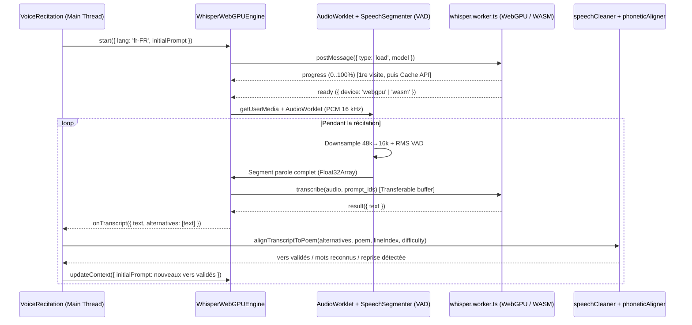

# Architecture technique — Reconnaissance vocale locale Whisper WebGPU (Option 2)

Ce document décrit en détail l'implémentation de la reconnaissance vocale **100 % navigateur et hors-ligne** sur la branche `feat/whisper-webgpu-stt`, basée sur **Whisper ONNX** via `@huggingface/transformers`, un **Web Worker**, un **AudioWorklet** de capture PCM 16 kHz et un **VAD** (détection d'activité vocale) léger, le tout branché sur le même pipeline de nettoyage d'hésitations et d'alignement phonétique La Fontaine que l'Option 1.

---

## 1. Objectifs & contraintes d'architecture

| Critère | Exigence | Réponse technique retenue |
| --- | --- | --- |
| **Hébergement** | 100 % statique sur GitHub Pages (aucun serveur, aucune clé API) | Exécution 100 % client-side dans un Web Worker |
| **Confidentialité** | Aucun flux audio envoyé vers un serveur tiers | Capture locale via Web Audio API + inférence ONNX locale |
| **Fluidité UI** | Zéro gel du thread principal pendant l'inférence | `AudioWorklet` (thread audio) + `Worker` (thread IA) |
| **Poids du bundle principal** | Ne pas alourdir le chargement initial pour les utilisateurs clavier/Web Speech | Worker ESM chargé paresseusement uniquement à la sélection de *Whisper Local* |
| **Vocabulaire XVIIe** | Reconnaître *l'Oût*, *nenni*, *vermisseau*, *gabelle*, *Ésope*… | Double levier : `prompt_ids` (`buildWhisperInitialPrompt`) + `lafontaineLexicon` & `phoneticAligner` |
| **Hésitations & reprises** | Filtrer *« euh »*, *« oh non je recommence, je me suis trompé »* | `SpeechSegmenter` (VAD) + `cleanSpokenTranscript` + `alignTranscriptToPoem` |

---

## 2. Architecture globale & flux de données

---

## 3. Détail des composants clés

### 3.1. Capture audio & VAD (`src/services/speech/audioCapture.ts`)
- **`AudioWorkletNode` (`pcm-capture-processor`)** : injecté via un `Blob` URL pour éviter toute configuration spécifique au `base` GitHub Pages. Contrairement à l'ancien `ScriptProcessorNode`, la capture s'exécute hors du thread principal.
- **Rééchantillonnage linéaire 16 kHz (`downsampleTo16kHz`)** : Whisper attend impérativement du PCM mono 16 kHz (`Float32Array`). Le micro navigateur capture généralement à 44,1 kHz ou 48 kHz ; les échantillons sont moyennés par fenêtre vers 16 kHz.
- **Détection d'activité vocale (`SpeechSegmenter`)** :
  - Calcule l'énergie RMS (`computeRms`) de chaque trame.
  - Conserve un **pre-roll** de 3 trames pour ne jamais couper la consonne initiale d'un vers.
  - Émet un segment audio vers Whisper dès qu'un silence de **750 ms** suit au moins **350 ms** de parole (ou au bout de **12 s** max lors d'une récitation continue longue).
  - *Pourquoi un VAD RMS pur TypeScript plutôt que Silero VAD ONNX dès le départ ?* Zéro asset `.onnx`/`.wasm` supplémentaire à copier dans `public/`, 100 % testable unitairement sous Vitest, latence nulle. Pour les environnements très bruyants, un remplacement ciblé par `@ricky0123/vad-web` (Silero VAD) est prévu dans le même contrat `MicrophoneSegmentRecorder`.

### 3.2. Inférence Whisper dans un Web Worker (`src/workers/whisper.worker.ts`)
- **Détection matérielle automatique** :
  1. Teste `'gpu' in navigator && Boolean(await navigator.gpu.requestAdapter())`.
  2. Si WebGPU est disponible : charge le modèle avec `device: 'webgpu'` et quantification hybride `{ encoder_model: 'fp32', decoder_model_merged: 'q4' }` (meilleur compromis vitesse GPU / précision décodeur en français).
  3. En cas d'absence de WebGPU ou d'échec d'initialisation GPU : bascule automatiquement en `device: 'wasm'`, `dtype: 'q8'` (CPU WebAssembly mono-thread compatible GitHub Pages sans COOP/COEP).
- **Mise en cache persistante** : `env.useBrowserCache = true` stocke les poids ONNX dans la Cache API du navigateur. Après le premier téléchargement, les démarrages suivants sont quasi instantanés et fonctionnent hors-ligne.
- **Transfert mémoire zéro-copie** : le buffer audio `Float32Array` est transféré au Worker via `[pcm16k.buffer]` (Transferable Object), évitant toute duplication mémoire.

### 3.3. Choix des modèles (`WhisperModelVariant`)

| Modèle | ID Hugging Face | Taille téléchargée (approx.) | Vitesse WebGPU | Précision français littéraire | Usage recommandé |
| --- | --- | --- | --- | --- | --- |
| **`base`** (défaut) | `onnx-community/whisper-base` | ~85 Mo | Très rapide (< 0,5 s / vers) | Bonne (renforcée par `phoneticAligner`) | Utilisation courante, PC portables & mobiles |
| **`small`** | `onnx-community/whisper-small` | ~240 Mo | Rapide (~0,6–1,2 s / vers) | Très bonne sur le lexique XVIIe | Desktop avec GPU dédié ou Apple Silicon |

---

## 4. Biais lexical La Fontaine & prévention des hallucinations

Whisper est un modèle encodeur-décodeur génératif : son décodeur accepte un préfixe de tokens (`prompt_ids`, plafonné à ~200 tokens dans `whisper.worker.ts`) qui conditionne fortement son vocabulaire et sa ponctuation.

### Stratégie implémentée (`buildWhisperInitialPrompt` dans `src/data/lafontaineLexicon.ts`)
1. **Contexte stylistique court** : `Fable de Jean de La Fontaine : <Titre>.`
2. **Glossaire filtré de la fable active** (14 termes max extraits automatiquement par `extractFableGlossary`) : mots archaïques connus, noms propres en milieu de vers (*Corbeau*, *Renard*, *Phénix*, *Fourmi*, *Cigale*) et mots rares/longs (*vermisseau*, *emprunteuse*, *alléché*, *gabelle*).
3. **Mémoire glissante des 2 derniers vers DÉJÀ validés** : mise à jour dynamiquement via `engine.updateContext(...)` au fur et à mesure que l'utilisateur progresse.

### Garde-fou anti-hallucination
> **Règle absolue** : ne **jamais** injecter les vers *futurs* (non encore récités) dans `prompt_ids`.
> Dans le cas contraire, Whisper tend à poursuivre le texte du prompt même sur un bruit de fond ou un bafouillement, validant faussement un vers non récité. Le glossaire seul oriente l'orthographe sans donner la syntaxe de la suite.

---

## 5. Spécificités de déploiement sur GitHub Pages

| Point technique | Comportement sur GitHub Pages |
| --- | --- |
| **Headers COOP / COEP (`SharedArrayBuffer`)** | GitHub Pages ne permet pas de configurer des en-têtes HTTP personnalisés. **WebGPU** n'en a pas besoin, et le fallback **WASM mono-thread** d'ONNX Runtime fonctionne nativement sans COOP/COEP. Si l'on souhaite activer WASM multi-threadé plus tard sur CPU seul, il faudra soit ajouter `coi-serviceworker`, soit héberger sur Cloudflare Pages / Netlify avec headers `Cross-Origin-Opener-Policy: same-origin` et `Cross-Origin-Embedder-Policy: require-corp`. |
| **Origine des poids ONNX** | Téléchargés directement depuis `huggingface.co` (CORS autorisé) puis mis en cache dans le navigateur de l'utilisateur — zéro dépassement de quota GitHub Pages. |
| **Vite 8 + Web Worker** | Déclaré via `new Worker(new URL('../../workers/whisper.worker.ts', import.meta.url), { type: 'module' })` pour que Vite génère un chunk worker séparé respectant automatiquement `base: '/lafontaine-recitation-training/'`. |
| **HTTPS obligatoire** | `navigator.mediaDevices.getUserMedia` et `AudioWorklet` exigent un contexte sécurisé (`https://` sur GitHub Pages ou `http://localhost` en dev). |

---

## 6. Pistes d'évolution ultérieures

1. **VAD neuronal (Silero VAD)** : remplacer `SpeechSegmenter` par `@ricky0123/vad-web` pour une meilleure robustesse dans les environnements bruyants (bruit de rue, musique de fond).
2. **Inférence streaming intermédiaire** : envoyer des fenêtres glissantes toutes les 1,5 s pendant une longue tirade pour afficher les mots verts en temps réel avant même la pause de 750 ms.
3. **Connecteur Cloud optionnel (`CloudSTTEngine`)** : implémenter la même interface `SpeechEngine` vers **Mistral Voxtral Realtime**, **Gemini 3.5 Transcribe** ou **Deepgram Nova-3** (via Cloudflare Worker proxy ou clé utilisateur BYOK) pour une précision studio sans téléchargement de modèle.
